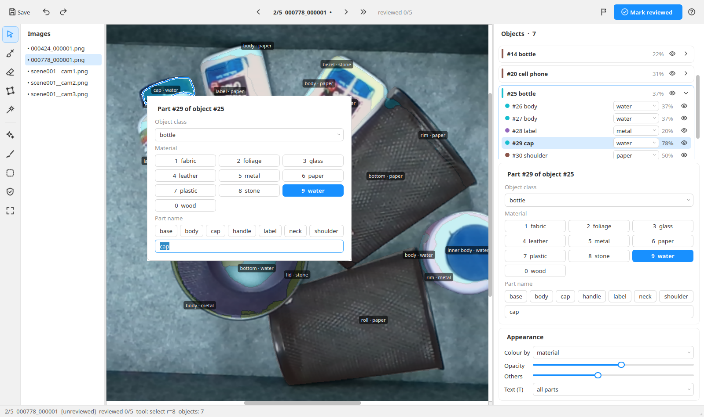

# AnnoFix

A desktop tool for **fixing automatically generated object → part → material masks**. An
annotation pipeline labels every object in an image, splits it into parts (cap, body, label…)
and gives each part a material, but its masks need a human pass: jagged or bleeding edges, loose
specks, wrong names and materials. AnnoFix opens the pipeline's output (CVAT-style COCO), lets
you fix it quickly, and writes it back in the same format.

Most fixes are one key on the selected part. SAM 2.1 refits its mask in place, keeping the part's
labels (`R`). Straight edges get straightened (`L`). The whole image can be auto-cleaned
(`Shift+R`). It looks and feels like CVAT, and every pixel belongs to exactly one part of one
object, so parts never overlap or leave gaps.



## Requirements

Not on Linux, or rather not install anything? Use [Docker](#run-with-docker-windows-mac-or-linux)
instead: it needs only Docker and a browser.

- **Linux** (tested on Ubuntu 24.04). Python 3.12 is installed for you by `uv`.
- **[uv](https://docs.astral.sh/uv/)**, the Python package manager:
  `curl -LsSf https://astral.sh/uv/install.sh | sh`
- **Qt's system library** (missing on a fresh Ubuntu; without it the window will not open):
  `sudo apt install libxcb-cursor0`
- **~12 GB of free disk**: PyTorch and its NVIDIA libraries are large.
- **GPU: optional.** With an NVIDIA GPU, SAM runs on it (an RTX 3050 with 6 GB works). Without
  one, SAM runs on the CPU (slower), or you can run without SAM (`--no-sam`); everything else
  works the same.
- **Internet on first SAM use**: the SAM 2.1 weights (~150–900 MB) download from Hugging Face
  the first time you press `R`.

## Install

```bash
git clone https://github.com/Team-RRC-IIITH/AnnoFix.git
cd AnnoFix
SAM2_BUILD_CUDA=0 uv sync
```
The environment (`.venv`) is about 5.7 GB, and uv's download cache holds about as much again. On
a slow or flaky connection, download one file at a time:
```bash
UV_CONCURRENT_DOWNLOADS=1 UV_HTTP_RETRIES=10 UV_HTTP_TIMEOUT=600 SAM2_BUILD_CUDA=0 uv sync
```

## Run with Docker (Windows, Mac or Linux)

AnnoFix runs inside a container and you use it in your browser. You need only
[Docker](https://docs.docker.com/get-docker/) (Docker Desktop on Windows and Mac), not Python
or Qt.

```bash
git clone https://github.com/Team-RRC-IIITH/AnnoFix.git
cd AnnoFix
scripts/annofix-docker.sh /path/to/samples          # fixes go to /path/to/samples_fixed
```
Then open **http://localhost:6080**.
- **First run:** it builds the image, which takes about 10 minutes on a slow connection and ends
  up about 2.9 GB. Later runs start in seconds.
- **Stopping:** `Ctrl+C` in the terminal saves your work and stops AnnoFix.
- **Your data:** the samples folder is mounted read-only. Only the fixes folder is written, and
  it belongs to you.
- **SAM:** its weights download the first time you press `R` and are kept in a Docker volume
  (`annofix-models`).

More ways to run it:
```bash
scripts/annofix-docker.sh SAMPLES OUT                     # choose where the fixes go
scripts/annofix-docker.sh SAMPLES -- --annotator NAME     # AnnoFix options after --
scripts/annofix-docker.sh --gpu SAMPLES                   # NVIDIA GPU: faster SAM, ~8 GB image
SCREEN_SIZE=1920x1080 scripts/annofix-docker.sh SAMPLES   # a bigger desktop in the browser
```
- **GPU image:** it needs an NVIDIA driver and the
  [NVIDIA Container Toolkit](https://docs.nvidia.com/datacenter/cloud-native/container-toolkit/latest/install-guide.html)
  on the host.
- **The CPU image** (the default) works everywhere. SAM is just slower in it.
- **Without bash** (Windows PowerShell), create the output folder first, then:
  ```powershell
  $env:SAMPLES="C:\data\samples"; $env:OUT="C:\data\samples_fixed"; docker compose up --build
  ```
- **Browser keys:** the browser keeps a few keys for itself: `Ctrl+N`, `Ctrl+W`, `F1`. In the
  tab, use `?` for the shortcut list and the toolbar for a new empty part.
- **Network:** port 6080 is only reachable from this computer.

## Quick start: fix the pipeline's output

The pipeline writes one folder per sample, at any depth:
```
SAMPLES/
  000778_000001/
    images/000778_000001.png
    annotations/instances_default.json     COCO: categories = materials, one annotation per object and per part
    export_manifest.json                   optional, kept if present
    cvat_labels.json                       optional, kept if present
  scene001/cam1/…                          nested folders are fine (shown as scene001__cam1)
```
Open them with:
```bash
scripts/annofix.sh SAMPLES                  # fixes go to SAMPLES_fixed/ next to it
scripts/annofix.sh SAMPLES OUT              # ...or to OUT/
scripts/annofix.sh SAMPLES -- --device cpu  # options after -- go to AnnoFix (see below)
```
- `SAMPLES` is **never changed**. Every save writes that sample to `OUT/<sample>/` in the same
  layout and files, ready for CVAT or the next pipeline step. There is no export step.
- Run the same command again later: your edits are kept, and new samples added to `SAMPLES` are
  picked up.
- Options: `--annotator NAME` (recorded in what you save), `--no-sam`, `--device cuda|cpu`,
  `--sam-model tiny|small|base_plus|large`, `--checkpoint FILE.pt` (use SAM offline), and
  `--export-only` (rewrite every output without opening the window).

The script is a shortcut for
`uv run python -m annofix.cvat SAMPLES --out OUT [options]`.

## Fixing an image, step by step

1. **Look over the image.** Each part's `name · material` is written on it (`T` cycles: all
   parts → the selected object's → off). The cards on the right list the objects and their
   parts, each with the pipeline's confidence.
2. **Wrong name or material:** right-click the mask. Its card opens right there; press a
   material's number key (`1`–`9`, `0`), or type a part name and press Enter.
3. **Bad edge:** click the part and press `R`. SAM redraws the same mask, and `Tab` shows
   other answers. Press `Enter` to keep it, or `Esc` to leave the part as it was.
4. **Straight edge drawn as a zigzag** (boxes, screens, trays): click the part, then `L`, then
   `Enter`.
5. **Specks and ragged edges everywhere:** `Shift+R` cleans the whole image; check the preview
   and press `Enter`.
6. **Anything else:** the brush (`B`), eraser (`E`) and outline points (`G`).
7. **Done:** `Ctrl+Enter` marks the image reviewed and opens the next unreviewed one.

Every change is one undo step (`Ctrl+Z`). Work saves by itself; `F1` lists every key.

## The window

The window is laid out like CVAT's annotation view.

- **Top:** save, undo/redo, previous/next image and next unreviewed, the image and how many are
  reviewed, flag, **Mark reviewed**, help.
- **Far left:** the tools (select, brush, eraser, points, SAM), then auto-clean, straighten,
  outlines, protect and fit. Every button's tooltip gives its key.
- **The images list:** ○ no annotation yet · • unreviewed · ✓ reviewed · ⚑ flagged.
- **The image with its masks:** part borders are drawn darker, so neighbouring parts of the same
  colour stay distinct.
- **Right-click a mask** to open its card right there, as in CVAT:
  - Type the part name (Enter applies and closes).
  - Pick a material (1–9, 0 or click; the card stays open).
  - Change the object class.
  - A click elsewhere keeps what you typed; `Esc` drops it.
- **Right:**
  - The objects as cards. An eye shows or hides; each part row has its own material list. A
    click selects, Ctrl+click adds. Right-click to move a part, split it off, clean or delete it.
  - The selected part's class, material and name.
  - Appearance: colour by, opacity, others, text.
- **Selection:** a selected part keeps its true colour and gets a white-and-blue outline. The
  other parts fade while it is selected (Appearance → Others; 100% turns that off).

Work saves 2 s after your last finished edit (never in the middle of a stroke), every 30 s, when
you change image, and on close. Ctrl+C in the terminal also saves and closes.

## Keys

| To do this | Press / click |
|---|---|
| Select a part · add/remove one | click · Ctrl+click (on the image or in the cards) |
| Set material | `1`–`9`, `0` (10th) (keypad too) or a material button |
| Part name · object class | suggestion buttons, or type: applied on Enter or as soon as you do anything else; `Esc` drops it. Applies to every selected part |
| Next part with a missing label | `P` |
| Give the selected parts the last name + material again | `.` |
| Brush (paint the selected part) · eraser · select | `B` · `E` · `V` |
| Points: drag the selected part's outline points · add one · delete one | `G`, then drag · double-click an edge · Ctrl+click a point |
| Brush size | `[` `]` |
| Protect other parts while painting | toolbar toggle |
| Cancel a stroke | `Esc` |
| Merge selected parts · merge their objects | `M` · `Shift+M` |
| Delete part(s) · delete object | `Del` · `Shift+Del` |
| Undo · redo | `Ctrl+Z` · `Ctrl+Shift+Z` |
| Edit a part's name, material, class at the mask | right-click it |
| Text on masks: all parts → selected object → off | `T` |
| **Improve** the selected part with SAM (from its own mask; `Tab`: other answers, the mask smoothed) | `R` |
| Redraw a part that is plain wrong from clicks | `Esc`, then click it with the SAM tool |
| SAM: include · exclude · box | left click · right click · Shift+drag |
| SAM: next/previous candidate · replace · add · cancel | `Tab`/`Shift+Tab` · `Enter` · `Shift+Enter` · `Esc` |
| Auto-clean every mask (SAM, else smoothing) · accept · discard | `Shift+R` · `Enter` · `Esc` |
| Straighten zigzag edges: selected part · every part · accept · discard | `L` · `Shift+L` · `Enter` · `Esc` |
| Points tool: straighten one stretch (box over its points, then) · show every corner | `L` · `Shift+G` |
| Points tool: fewer · more outline points (few → normal → fine → every corner → every 5 px) | `[` · `]` |
| New part · new object (with SAM: from clicks) | `N` · `Shift+N` |
| New empty part, brush ready (also with SAM) | `Ctrl+N` |
| Hide masks while held · solo object · outlines | `Space` · `S` · `O` |
| Next/previous object | `J` · `K` |
| Previous/next image · next unreviewed | `A` · `D` · `Ctrl+U` |
| Mark reviewed (checks every label) and open the next unreviewed · flag | `Ctrl+Enter` · `F` |
| Save now | `Ctrl+S` |
| Zoom · pan · fit the image | mouse wheel · middle- or right-drag (right-drag not in SAM mode) · `Home` |
| All shortcuts | `F1` · `?` |

## How the fixes work

**Improve one part (`R`)** keeps the part and makes its mask better.
- SAM is asked with prompts taken from the mask itself, so no clicks are needed: its box,
  points inside it, and points on the neighbours to keep out.
- If SAM's closest answer matches the mask well, it is shown first. If not (SAM found
  something else), the mask smoothed is shown first.
- `Tab` steps through SAM's answers and the smoothed mask; clicks refine SAM's answer.
- `Enter` writes the chosen mask into the same part, as one undo step. Its name, material,
  object and CVAT uid stay. `Esc` leaves it as it was.

**Straighten (`L`, `Shift+L`)** turns a part's zigzag edges into straight lines.
- A line is fitted through each stretch of the outline, through the middle of the zigzag rather
  than along its bumps (as the points tool's outline is), and the part is filled from those
  lines.
- Only edges that really are straight are changed. Round parts (bowls, caps) are left as they
  are, and so are outlines too rough to tell (big upscaling staircases: use `R` there).
- Shared edges never open a gap: what a part lets go of goes to its neighbour.
- It shows as a preview. `Enter` applies it as one undo step, `Esc` drops it.
- `Shift+L` does every part in the image, but only clearly straight ones.

**One stretch, exactly (points tool):** drag a box over outline points and press `L`.
- The outline from the first to the last boxed point becomes one straight line, and the points
  between go.
- The part's pixels along it follow that line exactly, even where the outline already looked
  straight but the pixels under it zigzagged.
- `Shift+G` shows every corner of the real pixel edge instead of the simplified few, so you can
  start and end the line exactly where you want.
- One undo step; `Esc` drops the picked points.

**Auto-clean (`Shift+R`)** cleans every mask in the image at once.
- SAM is asked again for each object and part, prompted from the mask it has: its box, points
  inside it, and points on its neighbours to keep out.
- Where SAM's answer matches the old mask well, it is taken, so edges follow the image.
  Elsewhere the mask is only smoothed (staircase edges, specks and pinholes).
- The changes show as a preview. `Enter` accepts them as one undo step, `Esc` drops them.
- Hidden parts are never changed. Without SAM, `Shift+R` smooths only.

**Points (`G`)** suit straight edges such as boxes and lids.
- Drag a corner and only the pixels along the edges at that corner change; the part follows the
  new edges exactly there, and the rest stays as it was.
- Holes stay holes, and other pieces of the part are never cut.
- A move that would make the outline cross itself is refused.
- Protected or hidden parts keep their pixels. Tiny specks get no points.
- For ragged or bleeding edges, use the brush or SAM.

**SAM** loads on first use (`R`), in the background; the status bar shows its state.
- The preview colours what Enter would do: white kept, green added, orange taken from another
  part, red removed.
- Hidden parts (and parts outside a solo object) are never changed, by SAM, the brush or the
  eraser. "Protect other parts" applies to SAM as it does to the brush.
- If SAM fails to load, its button disappears and the status bar says why; the brush keeps
  working.
- If the GPU is full, SAM loads on the CPU instead and says so. `--device cpu` never touches the
  GPU.
- SAM's pinholes and stray specks are cleaned up as smoothing does.

## How the pipeline's data is kept

- **Object = its parts + a `body` part.**
  - The editor gives each pixel one owner, so on import an object's pixels not covered by its
    parts become a part named `body`, carrying the object's material.
  - On export the object mask is again the union of its pieces, and the object's category is
    the body's material (with no body: the material covering most of the object).
  - A new object's first part, and a part split off into an object of its own, is its body.
    Rename a body and it is exported as a part.
  - Overlap slivers between different objects go to the smaller object; anything lost that way
    is printed when the sample is imported.
- **Materials and names:** the materials are the COCO categories (keys `1`–`9`, `0`). Object
  classes and part-name suggestions are collected from the data into `OUT/.annofix/labels.yaml`.
- **Ids:** uids, object ids, confidences and per-annotation `reviewed` flags are kept.
  - A new object gets an `object_id` after the source's (uid `o<N>`, confidence 100).
  - A new part gets uid `p<object>_<k>`, with `k` after the source's.
  - These never change between saves, and a deleted annotation's uid is never handed out again
    (the numbers can have gaps).
- **Missing labels:** anything without a material yet is left out of the output (the status bar
  says what) rather than given a guessed one.
- **Review status:** an image comes in as reviewed only if the source marks every annotation
  reviewed and its labels pass the checks. Marking it reviewed in AnnoFix sets `reviewed: true`
  on all its annotations.
- **Working copy:** it lives in `OUT/.annofix/` (AnnoFix's own format). A sample already there
  is never re-imported. On start, any output older than its working copy (say, an export that
  failed) is written again.
- **Polygons:** COCO polygons cannot hold holes, and a part's polygons may differ from the
  pipeline's by about a pixel at the boundary.

## Troubleshooting

| Problem | Fix |
|---|---|
| `Could not load the Qt platform plugin "xcb"` | `sudo apt install libxcb-cursor0` |
| `usage: scripts/annofix.sh SAMPLES …` | Give the folder of samples: `scripts/annofix.sh path/to/samples` |
| SAM is slow, or says it loaded on the CPU | Another program (e.g. CVAT's SAM) holds the GPU. Close it, or use a smaller model: `-- --sam-model small` |
| No internet for the SAM download | Download a `sam2.1_hiera_*.pt` checkpoint elsewhere and pass `-- --checkpoint FILE.pt` |
| Something went wrong | Errors are logged to `OUT/.annofix/annotations/annofix-errors.log` |
| Docker: `set SAMPLES to the folder…` | Use `scripts/annofix-docker.sh SAMPLES`, or set `SAMPLES` and `OUT` before `docker compose up` |
| Docker: the browser page doesn't load | Wait for "AnnoFix is starting" in the terminal; on another port: `PORT=6081 scripts/annofix-docker.sh …` |
| Docker on Ubuntu (snap): a folder looks empty in AnnoFix | Snap Docker only sees folders under your home directory; move or copy the samples there |
| Docker: `could not select device driver "nvidia"` | The GPU image needs the NVIDIA Container Toolkit; use the CPU image (without `--gpu`) |

After a crash, finished edits are saved and a half-finished stroke is rolled back. An annotation
file that cannot be read (broken JSON, an unknown review status) is reported and skipped, or
treated as unreviewed; it never stops the tool from starting.

## Other ways to use it

**AnnoFix's own format**, without the pipeline:
```bash
uv run python -m annofix --images IMAGES_DIR --annotations ANNOTATIONS_DIR [--labels labels.yaml] [--annotator NAME] [SAM options]
```
Per image `<stem>`, there are two files:
- `<stem>.parts.png`: single-channel **uint16**, pixel = part id, 0 = background (one owner per
  pixel).
- `<stem>.json`:

```json
{"schema_version": 1, "image": "../images/x.png", "size": [720, 1280], "next_id": 17,
 "source": "amg", "annotator": null, "review_status": "unreviewed",
 "objects": [{"id": 1, "class": "screwdriver",
              "parts": [{"id": 3, "name": "handle", "material": "rubber"}]}]}
```
Unlabelled values are `null`. Ids are shared by objects and parts and never reused. Read one
from Python with `annofix.io.load(ann_dir, stem) -> (label_map, meta)`. Materials and object
classes (with suggested part names) live in `labels.yaml`.

**Starting annotations from scratch** (GPU), with SAM's automatic mask generator:
```bash
uv run python -m annofix.bootstrap --images IMAGES_DIR --out ANNOTATIONS_DIR
uv run python -m annofix.bootstrap --images IMAGES_DIR --out ANNOTATIONS_DIR --regroup --overwrite  # re-group cached masks, no GPU
uv run python scripts/render_overlay.py --images IMAGES_DIR --annotations ANNOTATIONS_DIR --out OVERLAY_DIR
```
- Existing annotations are skipped.
- `--overwrite` only replaces annotations that bootstrap itself wrote and that nobody has
  changed since (checked again right before each write).
  - Anything edited (even unreviewed), reviewed, flagged, written by the pipeline, or unreadable
    is reported as `protected` and left alone.
  - Close the editor on that folder first: edits it has not saved yet are not on disk, so
    bootstrap cannot see them.
- The mask cache records which image and which SAM settings produced it. A cache from a
  re-recorded frame or older settings is regenerated (or, under `--regroup`, reported as an
  error for that image) instead of being reused silently.
- Depth frames (`*_depth.png`) are ignored.
- On an RTX 3050 a 1280x720 frame takes ~5 s with the default `base_plus` model.

## Tests

```bash
QT_QPA_PLATFORM=offscreen uv run pytest            # everything except real SAM (~30 s)
ANNOFIX_SAM_TESTS=1 uv run pytest -m sam           # real SAM 2.1 (downloads models; two tests use a CamCalibration frame)
```
`QT_QPA_PLATFORM=offscreen` lets the window tests run without a screen (e.g. over ssh).

## Design notes

Design: `docs/superpowers/specs/2026-10-03-annofix-design.md`. Measurements and bootstrap
findings: `docs/notes/2026-10-03-m0-measurements.md`.
